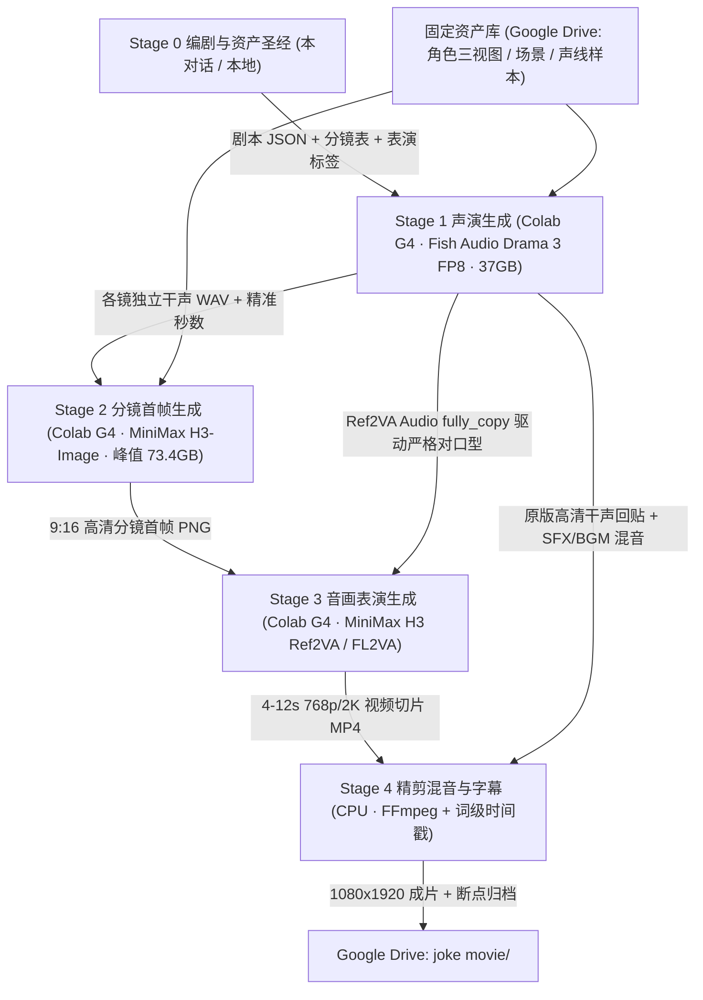

# Joke Movie 项目整体规划方案（从复刻到降维打击）

> **目标**：用 **Colab G4 (96 GB) + Fish Audio Drama 3 + MiniMax H3-Image + MiniMax H3** 搭建一套工业化、可日更的英文 AI 喜剧短视频（YouTube Shorts / TikTok / Reels）生产线。复刻 `@based-xlily` 类“AI 虚拟真人演英文笑话”的爆款流量公式，并在**镜头语言、喜剧演技、人物 IP、画质包装与商业变现安全性**上全面超越。

---

## 一、竞品样本拆解与超越策略

已逐条检视你提供的 3 条 `@based-xlily`（约 10.7 万粉、279 条视频、爆款播放 1M–3.9M）参考视频：

| 样本视频 | 形式与视觉构成 | 核心笑点机制 | 明显短板（“比较一般”的原因） |
| :--- | :--- | :--- | :--- |
| `arMTOoYCmkQ`<br>*"Is overstaying a visa actually illegal?"* | 夜景商业街 9:16 街采；左侧金发挑染黑发 AI 女主持握麦，右侧深发女路人；顶部亮黄黑描边大字钩子 | **概念反转**：用日常词汇反问戳破对方逻辑漏洞 | 双人并排罚站，单机位一镜到底；人物换脸无延续性；横转竖两侧毛玻璃垫底显廉价 |
| `_WWlU7_O47E`<br>*"Does locking your door make you racist?"* | 霓虹灯街边夜景 9:16 街采；香槟吊带女主持持 RODE 风格麦问棕衣男生；顶部黄字钩子 | **双标类比反杀**：受访者先抛出强观点，主持用“你锁不锁家门”一秒反杀致其语塞 | 对白节奏偏平，缺乏喜剧关键的“冷场憋笑/结巴停顿”；缺少特写反应镜头放大尴尬感 |
| `KFks6cfK_ps`<br>*"What's The Wildest Answer?!"* | 暗调 `COMEDY CLUB` 发光招牌 + 美国国旗背景；哥特风女演员坐着持麦，前排观众后脑勺与两侧反差路人围观 | **前排偷拍式脱口秀互动**：靠“围观群众的震惊/冷漠反应脸”制造真实临场感 | 画面中下方强行叠大红 Like/Subscribe 贴片破坏沉浸感；人物肢体与微表情仍有明显 AI 僵硬感 |

### 1.1 必须保留的底层流量密码
1. **极低理解门槛的“三拍笑话结构”**：`Setup（抛出反常识前提）→ Twist（一句话逻辑反转/神补刀）→ Freeze（对方社死/僵住反应）`，单条 20–35 秒，天然触发回看与评论区站队。
2. **伪实拍 / UGC 沉浸视角**：夜景街采、前排偷拍脱口秀比“精修棚拍”更有刷到真实八卦的代入感，能显著压低前 2 秒划走率。
3. **高视觉吸引力 + 明确悬念标题钩子**：0–2 秒画面内直接给出核心问句，静音刷到也能秒懂冲突。

### 1.2 我们的 5 大降维打击升级点（如何“做得更好”）
1. **从“双人罚站”升级为“微电影多机位剪辑（真 Joke Movie）”**
   - 不再一镜到底傻站着念稿，而是用 **3–5 个精准分镜**：建立镜（双人中景）→ 铺垫镜（受访者/对手近景）→ 反杀镜（主角过肩 OTS / 挑眉特写）→ **灵魂反应镜（Reaction Shot：对方眼神漂移、嘴唇微张说不出话、旁边路人憋笑）**。喜剧 50% 的笑点都在反应镜头里。
2. **从“AI 朗读”升级为“脱口秀演员级声演（Fish Audio Drama 3）”**
   - 利用 Drama 3 原生的方括号行内导演指令（`[deadpan]`、`[sighs]`、`[barely holding it together]`、`[stutters]`、`[chuckles]`）和 `previous_takes` 局部重录，精准拿捏**重音、语速急停、冷场前 0.6 秒停顿（Beat）**。
3. **从“每条换脸”升级为“固定明星班底 IP（MiniMax H3-Image 圣经）”**
   - 打造 2–3 位固定高辨识度主角（建立粉丝粘性，让观众“认人订阅”），用 H3-Image 的**单次最多 16 张参考图编辑**能力，直接把同一批主角 + 客串路人 + 道具 + 灯光合成出不同机位的精准分镜首帧，彻底消除跨镜换脸与服装漂移。
4. **从“高危暗黑擦边”升级为“犀利但可安全变现（Edgy & Monetizable）”**
   - `@based-xlily` 重度依赖政治/种族敏感话题，极易触发黄标限流或无法开启广告分成。我们保留**美式毒舌、逻辑悖论、荒诞反讽**的爽感，主攻高共鸣高转发的安全题材（男女约会双标、职场画饼/面试荒诞、生活逻辑陷阱、AI/科技日常讽刺、经典英美神反转段子剧场化），同时保住播放量和 RPM 收益。
5. **从“廉价横转竖贴片”升级为“原生 9:16 电影感精剪”**
   - 原生全屏 9:16 构图（无毛玻璃黑边）、词级高亮动态字幕（仅在 Punchline 关键词变色弹出，避开 Shorts UI 遮挡区）、广播级人声回贴 + 喜剧音效（冷场静默/轻度环境底噪/观众哄笑/Boom 转折音）+ 首尾无缝循环设计。

---

## 二、产品内容矩阵：3 套可复用的喜剧模板

为避免观众审美疲劳，同时把资产复用率拉满，规划 **3 套共享同一套管线的喜剧模板**：

| 模板 | 对应风格 | 单条时长与分镜数 | 核心场景资产（一次建好反复用） | 推荐占比 |
| :--- | :--- | :--- | :--- | :--- |
| **A. 街头逻辑陷阱**<br>`Street Logic Trap` | 升级版样本 1 & 2（霓虹夜景街采反转） | 20–30 秒<br>4 镜头（双人→路人→主持 OTS→路人呆滞反应） | 迈阿密霓虹商业街、酒吧街霓虹门头、大学城傍晚广场 | **40%**（起量最快、最易日更） |
| **B. 喜剧俱乐部前排视角**<br>`Comedy Club Crowd-Work` | 升级版样本 3（暗调俱乐部脱口秀 + 观众互动） | 25–35 秒<br>4–5 镜头（台上主镜→被点名观众→台上神补刀→前排哄笑/社死） | 复古砖墙 `COMEDY CLUB` 霓虹舞台 + 前排模糊观众席 | **30%**（极易打造个人 IP 与强记忆点） |
| **C. 微电影情景短剧**<br>`Mini-Skit Joke Movie` | 真正拉开代差的“英文笑话微电影”（类似 *Key & Peele* 浓缩版） | 30–45 秒<br>5–6 镜头（建景→对话拉锯→道具/反转特写→绝杀收尾） | 咖啡店柜台、诊所诊室、HR 面试间、夜间副驾车内（2 人室内光影极稳） | **30%**（订阅转化最高、护城河最深） |

---

## 三、技术架构：Colab G4 单卡 96GB 完整落地管线

你的工具选型**完全足够，而且正好踩中当前开源多模态的最强组合**。但要在 **1 张 Colab G4（NVIDIA RTX PRO 6000 Blackwell，96 GB VRAM）** 上跑得又稳又省钱，必须解决三个工程核心问题：**显存分阶段调度、磁盘权重复用、以及 Drama 3 与 H3 的精准口型对齐**。



### 3.1 各模型在 Colab G4 (96 GB) 上的最佳运行配置

| 阶段 | 模型 | Colab G4 (96 GB) 推荐部署方案 | 显存峰值 | 预估单次耗时 | 关键技巧 |
| :--- | :--- | :--- | :--- | :--- | :--- |
| **Stage 1<br>演戏级配音** | **Fish Audio Drama 3**<br>(`fishaudio/drama-3`) | **SGLang-Omni** 原生 FP8 MoE（无需降级 int4），OpenAI 兼容 `/v1/audio/speech` | **~37–45 GB** | 几秒出完整一集 | 用 `<\|speaker:0\|>` 多角切换 + `[deadpan]`/`[laughs]`/`[sighs]`；Punchline 不满意时传入 `previous_takes` 局部精修 |
| **Stage 2<br>角色/分镜首帧** | **MiniMax H3-Image**<br>(`MiniMaxAI/MiniMax-H3-Image`) | **vLLM-Omni** 单卡 `DiT resident + text_encoder layer offload`（6 步出图） | **~73.4 GB** | **~3.2 秒 / 张**<br>(2048 级画质) | 一次传多张参考图（主角三视图 + 路人图 + 场景图 + 话筒道具），直接出同一光影下的正面/OTS/特写首帧 |
| **Stage 3<br>视频与口型表演** | **MiniMax H3**<br>(`MiniMaxAI/MiniMax-H3`) | **方案 A（推荐首选）**：`Ref2VA` + **LightX2V 8-step Turbo LoRA**（`minimax_h3_ref2v_turbo_8step_v1.0_768p_bf16`，9 steps, `flow_shift=6`）+ 单卡 CPU/Layer Offload<br>**方案 B（Blackwell 极速）**：`FastVideo/FastH3-Omni-NVFP4-QAD`（8 步原生 NVFP4） | **< 85 GB**（单分区加载 + Offload） | **~25–60 秒 / 镜**<br>（5–8 秒 768p 片段） | 有台词镜头走 **Ref2VA**；纯冷场/呆滞反应镜头走 **FL2VA**（首尾帧控制眼神与微表情，避免无谓消耗音频 token） |
| **Stage 4<br>精剪与包装** | **FFmpeg + WhisperX/对齐** | 纯 CPU（可在 Colab 或本机秒完成） | 0 GB | < 10 秒 / 条 | 干声回贴 + `-14 LUFS` 响度标准化 + 喜剧音效叠轨 + 词级动态高亮字幕 |

### 3.2 决定成片上限的 4 个核心工程细节（避坑指南）

1. **Fish Drama 3 + MiniMax H3 协同黄金法则：`fully_copy` + 后期原声回贴**
   - MiniMax H3 `Ref2VA` 模式既支持把音频当“音色参考（`reference`）”，也原生支持在结构化提示词里声明 **`<Audio 1>: fully_copy`**，强制模型按传入的精确音频节奏生成**1:1 严丝合缝的口型、呼吸起伏与肢体节拍**。
   - **关键加分项**：H3 内置 AudioVAE 会将输出音频压缩到 32 kHz 重建；因此在 Stage 4 合成时，**把 Fish Audio Drama 3 的原始高清干声按时间轴回贴为主人声**，同时仅保留 H3 生成的环境底噪（或叠加可控的街道/俱乐部底噪与喜剧音效），兼得“顶级演技 + 精准口型 + 广播级音质”！
2. **绝不单条端到端切换模型 —— 采用“批次流水线（Batch-by-Stage）”榨干 G4 算力**
   - 96 GB 显存无法同时常驻三个 30B+ 模型，且每次重载权重都要耗 2–4 分钟。
   - **正确姿势**：一次先写好 **5–10 条笑话剧本** → Colab G4 开机先一口气跑完 **10 条的 Stage 1（Drama 3 干声）** → 释放显存 → 一口气跑完 **10 条的 Stage 2（H3-Image 分镜首帧）**（顺便人工抽检挑图，不满意秒重抽）→ 释放显存 → 一口气跑完 **10 条的 Stage 3（MiniMax H3 视频生成）**。不仅不 OOM，还能把 Colab 计算单元成本压低 **60% 以上**！
3. **共享 `Qwen3-VL-32B` 文本编码器，直接省 63 GB Colab 磁盘**
   - `MiniMax-H3-Image` 与 `MiniMax-H3` 共用同一份 `Qwen3-VL` text_encoder（约 63 GB）。在 Colab 磁盘约 200+ GB 的限制下，把两者指向同一个本地缓存/软链接目录，并将所有中间产出与最终成片实时同步到你的 Google Drive `joke movie/`，彻底防 Colab 断连丢进度。
4. **AI 友好型动作解耦（防止 H3 肢体崩坏与吞字）**
   - 单镜严格控制在 **4–10 秒**，英文台词 **≤ 18–22 词/镜**（绝不硬塞长段台词导致口型加速糊脸）；
   - 每个镜头只安排**单一主动作动量**（如“微微挑眉 + 递麦前倾”或“愣住眨眼两次 + 尴尬撇嘴”），并在首帧与提示词中锁死左右站位（180° 轴线不乱跳）。

> [!NOTE]
> **合规与平台风控提示（提前知悉）**
> - **模型许可**：`Fish Audio Drama 3` 社区协议在年营收 **\$500,000** 以下可免费商用（需保留归属说明）；`MiniMax H3 / H3-Image` 的自托管开源权重协议对美/欧/英/韩地区有限制，若后续面向欧美做大规模商业化，请留意通过官方 API 或合规许可途径使用。
> - **YouTube AI 标注**：上传写实 AI 人物视频时，正常勾选 YouTube Studio 的“包含经过修改或合成的内容”声明即可——官方明确表示**真实申报不会限流**，反而能防止被系统误判下架。

---

## 四、Google Drive 资产与代码目录规划

所有资产将规范沉淀在你已绑定的 Google Drive 文件夹 `joke movie/` 下，做到“换一台 Colab 也能一键断点续跑”：

```text
joke movie/
├── 00_bible/                      # 制作圣经（全频道唯一真源）
│   ├── cast_bible.json            # 固定主角四层档案（人设/口癖/英文外貌词/固定声线 WAV）
│   ├── scenes_bible.json          # 高频场景底图与灯光规范（街采夜景/喜剧俱乐部/室内情景）
│   ├── assets_ref/                # 锁定后的角色三视图 PNG、场景底图 PNG、角色参考音 WAV
│   └── sfx_bgm/                   # 喜剧音效包（停顿静默/蟋蟀/轻笑/哄笑/Boom/极简喜剧底乐）
├── 01_scripts/                    # 结构化喜剧剧本（每集一个 JSON + 可读 MD）
│   └── EP001_script.json          # 含分镜表、Drama 3 表演标签、H3-Image/H3 提示词
├── 02_colab_pipeline/             # Colab G4 一键运行脚本 / Notebooks
│   ├── 01_stage1_drama3_tts.ipynb # 批量生成多角色干声 + 自动测量每镜时长
│   ├── 02_stage2_h3_keyframes.ipynb # 基于圣经多图参考批量生成 9:16 分镜首帧
│   ├── 03_stage3_h3_video.ipynb   # Ref2VA (fully_copy) / FL2VA 批量生视频（断点续跑）
│   └── 04_stage4_post_edit.py     # FFmpeg 干声回贴 + 喜剧音效 + 动态高亮字幕 + 导出
└── 03_episodes/                   # 单集产出归档
    └── EP001_xxx/
        ├── audio/                 # Stage 1 干声 WAV + 时间戳 JSON
        ├── keyframes/             # Stage 2 分镜首帧 PNG
        ├── clips/                 # Stage 3 视频切片 MP4
        └── final_ep001_9x16.mp4   # Stage 4 可直接发布的 1080x1920 成片
```

---

## 五、四阶段执行路线图


- **Phase 1：定调、建圣经、写前 3 条剧本**
  - 确定频道核心调性（纯安全犀利 / 轻暗黑反讽）、固定主角人设（建议先锁 1 位高辨识度女主持/笑匠 + 1 位毒舌搭档，路人按需生成）、前 2 个核心场景；
  - 产出 `cast_bible.json`、`scenes_bible.json` 和 3 条高质量英文喜剧分镜剧本（含 Drama 3 表演标签与 H3 结构化提示词）。
- **Phase 2：搭建 Colab G4 管线 & 跑出样片 EP001**
  - 编写 4 个模块化的 Colab Notebook / 脚本并同步到 Drive；
  - 在 Colab G4 上实跑 EP001 全流程，实测验证 `Qwen3-VL` 共享缓存、`Drama 3 → H3 Ref2VA (fully_copy)` 唇形同步精度，以及 Turbo LoRA / FastH3-NVFP4 的画质与耗时平衡。
- **Phase 3：对比 `@based-xlily` 做体验抛光**
  - 重点微调喜剧时间差（Punchline 前的 0.5s 留白、Reaction Shot 长度）、字幕排版安全区、片头 2 秒视觉/音频钩子和结尾无缝循环。
- **Phase 4：工业化批次量产**
  - 建立“每周一次 10 条剧本批量写作 → Colab G4 集中开机 1–2 小时按 Stage 1/2/3 批次出片 → 自动混剪归档”的节奏，将单条制作时间压到 15 分钟以内。
